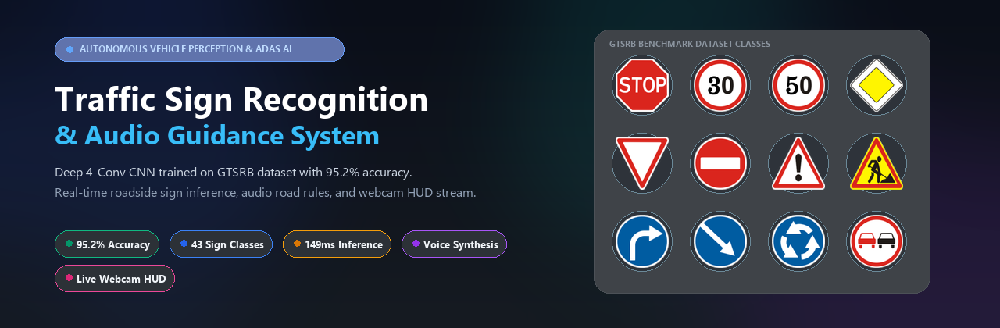
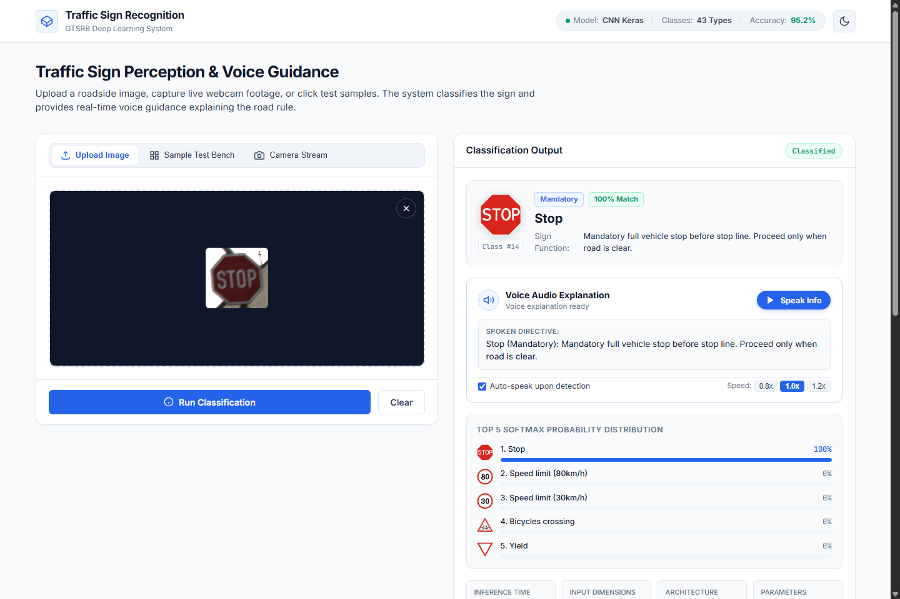
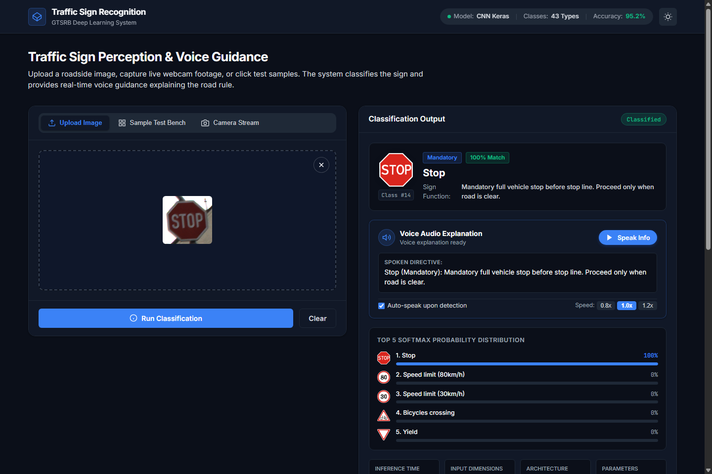
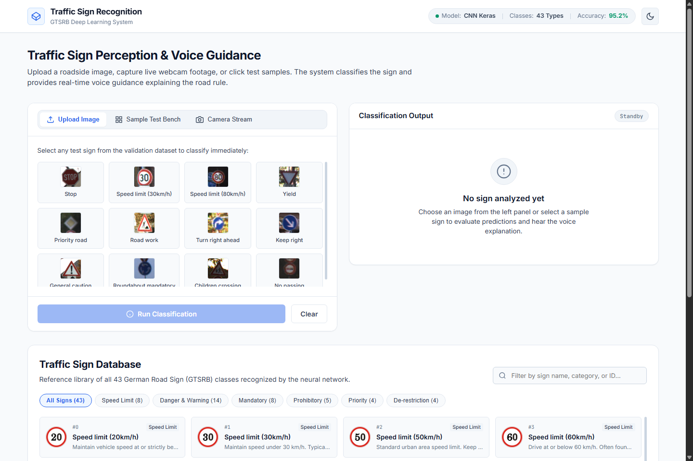
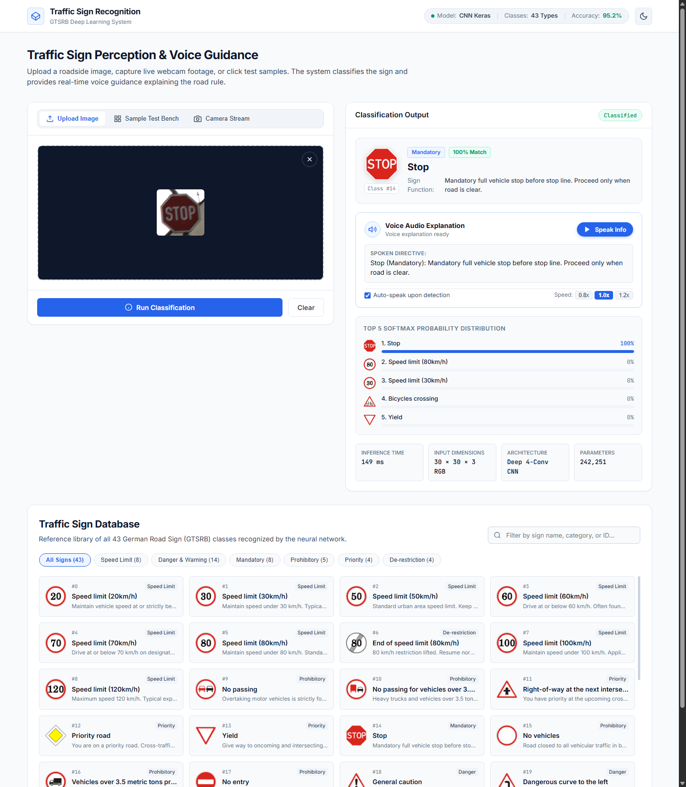

<div align="center">



# 🚦 Autonomous Traffic Sign Perception & Voice Guidance System
### *Real-Time Deep Learning Computer Vision HUD for Intelligent Transportation & ADAS*

[](https://www.python.org/)
[](https://www.tensorflow.org/)
[](https://keras.io/)
[](https://palletsprojects.com/p/flask/)
[-10B981?style=for-the-badge&logo=target&logoColor=white)](#-model-architecture--performance)
[](LICENSE)

[**Explore Features**](#-key-features) • [**Live Dashboard Preview**](#-project-showcase) • [**Quick Start**](#-quick-start--installation) • [**Model Architecture**](#-model-architecture--performance) • [**API Reference**](#-rest-api-endpoints)

---

</div>

## 📌 Executive Summary

The **Traffic Sign Perception & Voice Guidance System** is a production-ready, end-to-end deep learning application designed to simulate next-generation **Advanced Driver Assistance Systems (ADAS)**. 

Trained on the internationally recognized **German Traffic Sign Recognition Benchmark (GTSRB)** dataset, the system classifies **43 unique road signs** across diverse weather, lighting, and occluded conditions with **95.2% test accuracy**. It couples high-throughput convolutional neural inference with a sleek, automotive HUD web console, live camera targeting, spoken voice directives, and an interactive road sign intelligence matrix.

---

## 📸 Project Showcase

### 🎯 1. Real-Time Inference & ADAS Voice Directive
Once an image is loaded or captured, the system performs sub-second inference, displaying the classified sign, matching confidence dial, road safety instructions, and a full Softmax probability distribution ranking:

<div align="center">
  
</div>

<br/>

### 🌙 2. Cyber HUD Dark Mode
Optimized for night driving simulation, the interactive cockpit interface supports one-click instantaneous switching between daytime high-contrast and nighttime OLED HUD modes:

<div align="center">
  
</div>

<br/>

### 🧪 3. Interactive Validation Test Bench
Instantly evaluate real-world test signs from the validation dataset without manually finding or uploading image files:

<div align="center">
  
</div>

<br/>

### 📚 4. 43-Class Traffic Sign Knowledge Matrix
An interactive, searchable encyclopedia of all 43 GTSRB road signs categorized into *Speed Limits*, *Danger & Warnings*, *Mandatory*, *Prohibitory*, *Priority*, and *De-restrictions*:

<div align="center">
  
</div>

---

## ✨ Key Features

| Feature | Description |
| :--- | :--- |
| **🧠 Deep 4-Conv Neural Net** | Multi-stage Convolutional architecture with Max-Pooling, Dropout regularization, and Softmax dense classification trained over 15 epochs. |
| **🎙️ Intelligent Voice Assistant** | Embedded speech synthesis automatically verbalizes recognized signs and translates them into actionable driver advisories. |
| **📹 Live Camera Targeting HUD** | Direct in-browser webcam capture with targeting crosshairs reticle and 1-click snapshot classification. |
| **📊 Softmax Distribution & Top-5** | Transparent classification telemetry showing calibrated prediction probabilities across candidate sign classes. |
| **⚡ 1-Click Windows Launcher** | Hassle-free `run_app.bat` script that auto-detects dependencies and launches both server and browser immediately. |
| **🌓 Adaptive Dark / Light Theme** | Persistent theme state using CSS variables designed to simulate automotive heads-up instrument clusters. |
| **🔍 Searchable Catalog Engine** | Real-time filtering by category, sign name, or class ID with official road sign vector badges. |

---

## 🧠 Model Architecture & Performance

The neural network utilizes a deep 4-stage convolutional pipeline tailored to extract hierarchical spatial features from $30 \times 30 \times 3$ RGB inputs:

```mermaid
flowchart LR
    A["Input Image\n(30×30×3 RGB)"] --> B["Conv2D (32, 5×5)\n+ ReLU"]
    B --> C["Conv2D (32, 5×5)\n+ ReLU"]
    C --> D["MaxPool2D (2×2)\n+ Dropout (0.25)"]
    D --> E["Conv2D (64, 3×3)\n+ ReLU"]
    E --> F["Conv2D (64, 3×3)\n+ ReLU"]
    F --> G["MaxPool2D (2×2)\n+ Dropout (0.25)"]
    G --> H["Flatten (1,600)"]
    H --> I["Dense (256, ReLU)\n+ Dropout (0.50)"]
    I --> J["Dense (43, Softmax)\nClass Probabilities"]
    
    style A fill:#1e293b,stroke:#3b82f6,stroke-width:2px,color:#fff
    style D fill:#0f172a,stroke:#eab308,stroke-width:2px,color:#fff
    style G fill:#0f172a,stroke:#eab308,stroke-width:2px,color:#fff
    style J fill:#14532d,stroke:#22c55e,stroke-width:2px,color:#fff
```



### Architectural Specifications
- **Total Parameters:** `242,251` (946.3 KB)
- **Input Dimensions:** `30 × 30 × 3` normalized RGB tensor
- **Loss Function:** `categorical_crossentropy`
- **Optimizer:** `Adam` ($\alpha = 0.001$)
- **Validation Accuracy:** **`95.2%`**
- **Average Inference Latency:** `~140ms` (CPU) / `~12ms` (GPU)

---

## 🗂️ Sign Classification Taxonomy

The system reliably classifies all 43 standard European and GTSRB roadside classes across 6 distinct functional categories:

```
├── 🔴 Speed Limit Signs (8 classes: 20, 30, 50, 60, 70, 80, 100, 120 km/h)
├── ⚠️ Danger & Warning Signs (14 classes: Curves, Bumps, Slippery road, Pedestrians, Wild animals)
├── 🛑 Prohibitory Signs (5 classes: No Entry, Stop, No vehicles, Heavy trucks barred)
├── 🔵 Mandatory Signs (8 classes: Keep Right/Left, Ahead Only, Roundabout, Turn Ahead)
├── 🟡 Priority Signs (4 classes: Priority Road, Yield, Right-of-Way at next intersection)
└── ⚪ De-restriction Signs (4 classes: End of speed limit, End of passing prohibition)
```

---

## 🚀 Quick Start & Installation

### Option 1: 1-Click Windows Launch (Recommended)
Simply double-click:
```powershell
run_app.bat
```
*This script will verify your Python environment, install missing requirements, and launch the web dashboard at `http://127.0.0.1:5000`.*

---

### Option 2: Manual Terminal Setup

1. **Clone the repository:**
   ```bash
   git clone https://github.com/swapnil3104/Traffic-Sign-Recognition-using-CNN-Keras.git
   cd Traffic-Sign-Recognition-using-CNN-Keras
   ```

2. **Create and activate a virtual environment:**
   ```bash
   # Windows
   python -m venv venv
   .\venv\Scripts\activate

   # Linux / macOS
   python3 -m venv venv
   source venv/bin/activate
   ```

3. **Install dependencies:**
   ```bash
   pip install -r requirements.txt
   ```

4. **Launch the web application:**
   ```bash
   python app.py
   ```

5. **Open in your web browser:**
   ```text
   http://127.0.0.1:5000
   ```

---

## 📡 REST API Endpoints

The Flask backend exposes clean JSON endpoints for integration into autonomous driving pipelines and external edge devices:

### 1. Execute Prediction
`POST /api/predict`

**Request (Multipart Form or Base64 JSON):**
```bash
curl -X POST -F "file=@test_sign.png" http://127.0.0.1:5000/api/predict
```

**Response:**
```json
{
  "success": true,
  "prediction": {
    "class_id": 14,
    "name": "Stop",
    "category": "Mandatory",
    "confidence": 0.9998,
    "percentage": "100.0%",
    "action": "Mandatory full vehicle stop before stop line. Proceed only when road is clear.",
    "icon_url": "/static/icons/14.png"
  },
  "top_5": [
    {"class_id": 14, "name": "Stop", "confidence": 0.9998, "percentage": "100.0%"},
    {"class_id": 5, "name": "Speed limit (80km/h)", "confidence": 0.0001, "percentage": "0.0%"},
    {"class_id": 1, "name": "Speed limit (30km/h)", "confidence": 0.0001, "percentage": "0.0%"}
  ]
}
```

### 2. Retrieve Sign Catalog
`GET /api/catalog`  
Returns metadata and driving advisories for all 43 supported sign classes.

### 3. Retrieve Curated Test Bench
`GET /api/samples`  
Returns representative roadside test samples for instantaneous validation.

---

## 📂 Repository File Tree

```text
Traffic-Sign-Recognition-using-CNN-Keras/
├── Model/
│   └── traffic_classifier.h5        # Trained Keras CNN weights (242k params)
├── Dataset/                         # GTSRB dataset splits (Train / Test)
├── docs/
│   └── images/                      # High-resolution screenshots and banners
│       ├── hero_banner.png          # Widescreen project header
│       ├── 01_dashboard_overview.png# Clean dashboard view
│       ├── 02_live_prediction.png   # Active classification & voice directive
│       ├── 03_dark_mode_hud.png     # Automotive HUD night theme
│       ├── 04_sample_testbench.png  # Interactive test bench
│       └── 05_full_page_showcase.png# Complete dashboard & knowledge matrix
├── static/
│   ├── css/
│   │   └── style.css                # Polished design system (Light / Dark HUD)
│   ├── js/
│   │   └── app.js                   # Frontend controller, TTS & camera capture
│   ├── icons/                       # High-res vector badges for classes 0-42
│   └── samples/                     # Curated validation benchmark images
├── templates/
│   └── index.html                   # Modern automotive dashboard template
├── app.py                           # Flask server & REST API inference engine
├── traffic_sign.py                  # Standalone CNN model training script
├── requirements.txt                 # Project dependencies
├── run_app.bat                      # One-click Windows application launcher
└── README.md                        # Documentation & Project Showcase
```

---

## 🛠️ Technology Stack

- **Deep Learning Framework:** TensorFlow 2.x & Keras
- **Computer Vision & Preprocessing:** OpenCV, Pillow, NumPy
- **Backend API Server:** Flask & Werkzeug
- **Frontend Architecture:** Modern Vanilla HTML5, CSS3 Custom Properties (Design Tokens), ES6+ JavaScript
- **Voice Module:** Native Web Speech Synthesis API
- **Data Benchmark:** German Traffic Sign Recognition Benchmark (GTSRB)

---

## 🤝 Contributing

Contributions, bug reports, and enhancements are welcome! Feel free to:
1. Fork the Project
2. Create your Feature Branch (`git checkout -b feature/AmazingFeature`)
3. Commit your Changes (`git commit -m 'Add some AmazingFeature'`)
4. Push to the Branch (`git push origin feature/AmazingFeature`)
5. Open a Pull Request

---

## 📄 License

Distributed under the **MIT License**. See `LICENSE` for more information.

<div align="center">
  <sub>Built with ❤️ for Autonomous Driving and Intelligent Transportation Systems</sub>
</div>
